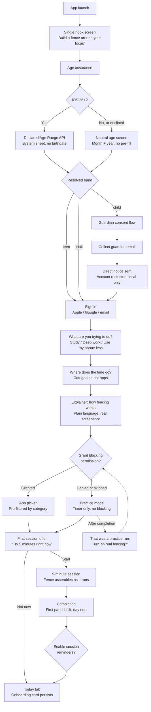
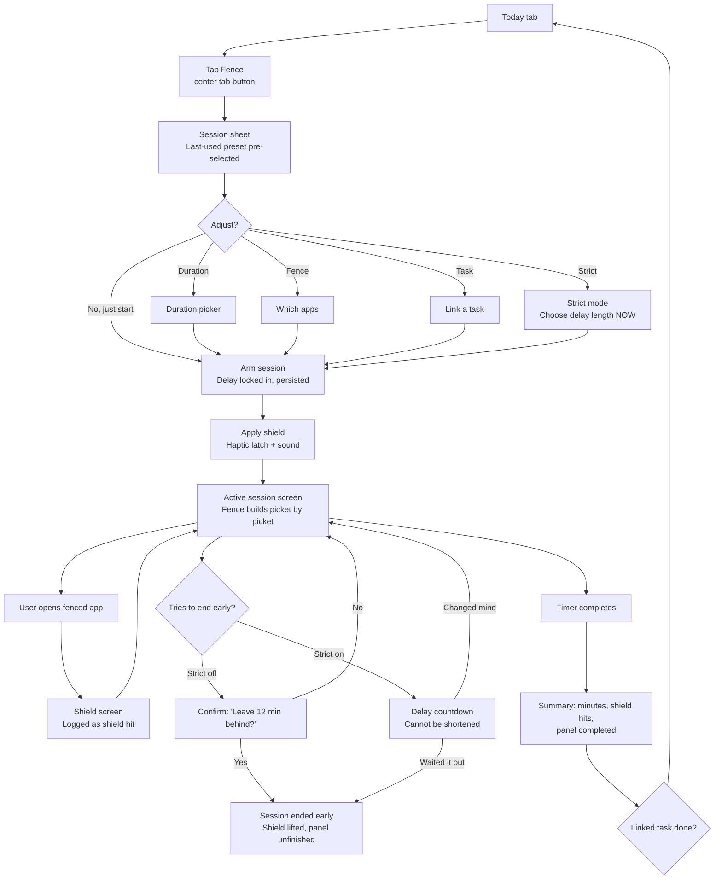
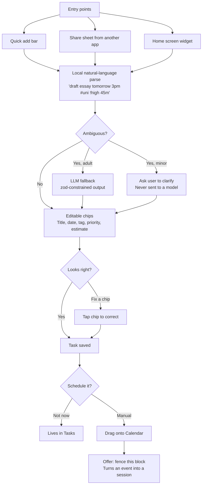

# Core User Flows

Three MVP flows — onboarding, starting a session, capturing a task — plus the monetization flow preserved as post-MVP design.

Two constraints shape all of them:

**Everything is unlocked.** There is no free/premium split in the MVP. Every user gets every shipped feature, subject only to age band. So there are no locks, no upsell interruptions, and no gated previews to design around.

**Age assurance comes before behavioral data.** Supporting under-16 users means establishing an age band before collecting anything, which forces login to the front of onboarding. This is a real cost to conversion and the flow below is built to minimize it. See [Under-16 Compliance](06-youth-compliance.md).

Terminology: a **fence** is a set of blocked apps. A **session** is a time-boxed period with a fence active. **Fenced Hours** are recurring scheduled sessions.

---

## Flow 1: Onboarding

**Goal:** get the user through a completed 5-minute session with real blocking active, having established their age band and created an account, in under 4 minutes.

The hard part is that compliance and conversion pull in opposite directions. Every app in this category wants to defer signup until after the user feels value. Youth compliance requires knowing who you are dealing with before you process their behavior. The resolution: make the age and auth steps genuinely fast — two taps via a system provider — and put every explanation *after* them.

### Screen by screen

**1. Hook (one screen, not a carousel).** Three-screen value carousels get skipped. Show the concept in one screen with a single continue button; the fence metaphor does the explaining.

**2. Age assurance.** On iOS 26+, call the Declared Age Range API — a system sheet returning a range without a birthdate, often guardian-declared, and the system may adjust thresholds to match local regulation automatically. Everywhere else, a neutral age screen asking month and year only.

Neutral means neutral: no pre-filled adult date, no visual steering toward the older option, no retry loop if you dislike the answer. Play's Families policy is explicit about this and it is also just the honest way to ask.

Frame it without making it feel like a checkpoint: "So we can set Fenced up correctly for you." Do not explain the regulatory reason here; it invites lying.

**3. Guardian consent, for under-13s only.** Collect a guardian email, send the COPPA direct notice, and let the child continue into the app in a **local-only restricted state** — sessions and blocking work, nothing behavioral syncs to the server — until consent is verified. This matters: a child who cannot use the app at all while waiting on a parent's email is a child who uninstalls. Blocking works locally, so let it work.

**4. Sign in.** Apple and Google one-tap first, email as the third option. Apple Sign In is mandatory on iOS if any other social provider is offered. Keep this screen to two taps; it is the price of everything else and should feel like a formality rather than a form.

**5. Intent selection.** "What are you trying to do?" This is not a survey — each answer configures real defaults:

| Intent | Default session | Default fence | Home emphasis |
|---|---|---|---|
| Study for exams | 50 min | Social + Video + Games | Streaks, total hours |
| Deep work | 90 min | Social + News + Messaging | Calendar and tasks |
| Use my phone less | 25 min | Social + Video | Shield-hit reduction |

Answering a question about yourself is a low-cost commitment that raises follow-through, and it saves shipping a settings screen the user must fill in before the app is useful.

**6. Distraction sources.** Pick categories, not individual apps: Social, Video, Games, Messaging, News, Shopping. Faster than scrolling an app list, and on iOS categories are the only path to category-level analytics later — nudge toward them here and you buy an analytics feature. See [platform constraints](05-platform-constraints.md).

**7. Explainer, before the prompt.** One screen, plain language, showing what is about to happen, including an actual screenshot of the OS permission screen — especially on Android, where the user must find a toggle in a system list with no dialog guiding them.

Copy differs because the mechanism differs:

- iOS: "Fenced uses Apple's Screen Time to cover distracting apps while you focus. We can't see what you do in them — Apple doesn't tell us."
- Android: "Android needs you to switch on Usage Access so Fenced can tell when a fenced app opens. We'll take you there — find Fenced in the list and flip the switch."

The iOS line is worth dwelling on: the privacy claim is *literally true* because of Apple's opaque tokens. Saying so converts the platform's biggest engineering limitation into a trust asset, and it is especially valuable for minors and their guardians.

**8. Permission request.** iOS calls `AuthorizationCenter.requestAuthorization(for: .individual)` — including for minors, per the MVP decision on authorization mode. Android sends the user to `ACTION_USAGE_ACCESS_SETTINGS`; detect return via lifecycle resume and verify the grant rather than assuming it.

**9. App picker.** iOS must use the system `FamilyActivityPicker` — you cannot build your own list. Present it inline so it feels like part of your app. Android builds its own picker from launcher-intent apps, pre-selected by chosen categories and sorted by actual usage, which is a nicer experience than iOS permits.

**10. First session.** Five minutes — short enough that nobody feels trapped, long enough to demonstrate the mechanism. A skip leaves a persistent card on Today.

**11. Completion.** The payoff. The first fence panel completes and the copy points forward: "That's day one. Come back tomorrow and the fence grows." For minors, keep this descriptive rather than pressuring.

**12. Notifications.** Requested *now*, after value, framed as a specific benefit: "Want a nudge when your Fenced Hours start?" Not "Fenced would like to send you notifications."

### Handling permission denial

Do not dead-end. Run **practice mode**: the full session UI, timer, and fence animation with no actual blocking, honestly labelled ("Practice run — apps aren't fenced yet"). The user experiences the loop and gets a well-timed re-ask on completion. Re-ask at most twice more, at natural moments (first Fenced Hours setup, first strict-mode attempt), then stop.

### Why not anonymous-first

An earlier version of this design deferred account creation entirely. Age assurance makes that untenable: you cannot establish a band, obtain guardian consent, or correctly restrict processing for a user you know nothing about, and behavioral data starts accumulating the moment the first session runs.

The mitigation is ordering and speed. Age assurance is a system sheet on modern iOS. Sign-in is two taps. Both happen before any explanation, so the user reaches the first session having answered two quick questions rather than having read four screens of marketing.

Instrument every step of this funnel separately. The age, auth, and permission steps are where this product lives or dies, and you cannot improve what you cannot see per-step.

---

## Flow 2: Starting a focus session

**Goal:** one tap from app open to fence active. This is the most-repeated action in the app and everything else is negotiable in its favor.

### Details that matter

**The session sheet defaults to the last-used configuration.** Repeat users tap the tab and tap start — two taps, no thinking. Every option on the sheet is optional.

**Strict mode's delay is chosen at arm time, never at exit time.** This is the whole feature. The user picks 5, 15, 30, or 60 minutes (or a custom value) while setting up the session, and that value is immutable for the session's duration. If the delay could be edited when trying to escape, it would be decorative. Persist it server-side and in the App Group at arm time so it survives restart, force-quit, and reboot.

Cap the delay for `child` accounts — an unbounded self-imposed lock is a wellbeing risk for a young user.

**Applying the shield is a moment.** Haptic thump plus a latch sound plus the gate closing. This is the app's signature interaction and it should feel physical. See [brand direction](03-brand-direction.md).

**The active session screen is deliberately boring.** Time remaining, what is fenced, and an exit path. No feed, no stats, nothing to explore — if the focus screen is interesting, it is a distraction. The one piece of motion is the fence assembling, which should reward a glance and not a stare.

**Shield hits are your best telemetry.** Every time the user bumps into the fence, log it (`ShieldAction` extension on iOS, overlay launch on Android). Do not surface a running count *during* the session — it shames the user mid-flow. Surface it in the summary and in weekly trends, where "you reached for a fenced app 14 times, down from 31 last week" is genuinely motivating.

**Platform difference to design around.** iOS interception is instant. Android polls at ~800ms, so the user glimpses their feed for up to a second. Make the Android overlay entrance fast and fully opaque so it reads as a decisive interception rather than a late one.

**Early exit costs something small.** Without strict mode, one confirmation naming what is lost ("Leave 12 minutes behind?"). With strict mode, the delay countdown, shown honestly. Neither can stop a user who deletes the app — say so in the strict mode description rather than claiming otherwise.

**The summary asks one question.** If a task was linked: "Did you finish it?" One tap closes the loop between focus and output, which is the entire reason to combine these three products in one app.

### Fenced Hours (scheduled sessions) — MVP

Same mechanism, no manual start. On iOS a `DeviceActivitySchedule` applies the shield with the app closed — the framework's intended use case, and it works well. On Android it is an alarm plus the foreground service, which is where OEM battery killers cause trouble, so verify the service survived and recover honestly if it did not.

Notify 5 minutes before a block starts, with a one-tap "skip today" that does not break the streak. A schedule the user cannot escape is a schedule the user deletes.

---

## Flow 3: Adding and scheduling a task

**Goal:** capture in under 3 seconds. Scheduling is a separate, optional step.

### Details that matter

**Parse locally first.** Dates, times, durations, `#tags` and `!priority` are regex-and-grammar work — instant, offline, free, deterministic. This covers the overwhelming majority of real input. Users type the same handful of patterns constantly and should never wait on a network round-trip for "gym tomorrow 7am."

**Minors never hit the LLM fallback.** For `child` and `teen` accounts the local parser is the only path; genuinely ambiguous input asks the user to clarify instead of escalating to a model. This keeps minors' data away from third-party model providers entirely, which removes a COPPA separate-consent requirement rather than satisfying it. See [youth compliance](06-youth-compliance.md).

**Always show the parse as editable chips.** Never silently interpret. The chips teach the syntax by demonstrating it, and they let the user fix a misread date in one tap instead of abandoning the feature after one bad guess.

**Close the loop back to focus.** After scheduling, offer to fence that block. This is the join between the three products: a task becomes a calendar event becomes a focus session, in one flow — exactly what the four-app-juggling user cannot do today.

### MVP calendar scope

The MVP calendar is **local, with reminders**, plus **two-way Google Calendar sync** and **ICS export**, both pulled forward from post-MVP by product decision. The caution that originally deferred them still stands: recurring-event expansion, timezone handling, tombstones, and conflict resolution make sync a project rather than a feature, and a sync bug that double-writes a user's real meeting is unforgivable. How each of those four is handled is documented in [Theming and Calendar Interop](08-theming-and-calendar-sync.md).

Voice-to-task, kanban, and AI auto-scheduling are also post-MVP. The MVP task manager is deliberately complete otherwise — subtasks, tags, priorities, recurrence, and local natural-language quick add — because a task list too weak to hold a user's real work means they keep using Todoist, and a user who never migrates never becomes a real user.

---

## Post-MVP: AI auto-scheduling

Preserved here because the design decision is load-bearing and should not be re-litigated later.

**A deterministic solver places tasks. An LLM only reads and writes language.**

The scheduler is ordinary code: given free/busy intervals, working hours, estimates, priorities, deadlines, buffers, and energy preferences, it produces placements via interval arithmetic and a greedy pass with constraint checks and backtracking. No model involved.

This matters for four reasons. It is testable with fixtures, reproducible for identical input, effectively free per run, and it cannot hallucinate a Tuesday that does not exist or silently double-book a meeting. An LLM placing calendar events directly gives you non-determinism, no test surface, per-run cost scaling with DAU, and occasional catastrophic output written into a user's shared work calendar.

The LLM's only jobs are parsing ambiguous input and writing one-line explanations ("moved to Thursday — Wednesday was already full").

A useful consequence: because the solver is deterministic code rather than a model, **minors can use AI auto-scheduling in full.** Only the optional explanation layer is withheld. That falls out of an architecture chosen for entirely different reasons.

**The proposal screen is a diff, never an auto-apply.** Show exactly what will be created and where, with the reason. Accept all, accept some, reshuffle, or reject. The user's calendar is shared with colleagues and family; writing to it without confirmation will lose you the account.

---

## Post-MVP: monetization and paywalls

There is no paywall in the MVP. This section preserves the design for when tiering ships.

**Principle: convert on demonstrated desire, not artificial obstruction.** The user should always finish a paywall encounter able to do *something*.

**Soft gates beat hard gates.** Most features should be visible and partly working rather than hidden behind a lock. A locked door tells the user nothing about whether the room is worth paying for.

- **Insights.** Show the real dashboard with the user's real numbers, limited to a 7-day window; unlock 90-day history and trends. Never show fabricated sample data — users recognize it and it reads as dishonest. Their own three sessions are more persuasive than a beautiful fake chart.
- **AI auto-scheduling.** Run the solver — it costs nothing. Show the actual proposal for their actual tasks and disable only Apply. They have now seen precisely what they would be buying, computed on their own week. This is the strongest paywall available and it is nearly free to build.
- **Strict mode.** Leave the toggle visible with its real explanation. A user who taps it has already decided they want it.

Reserve hard gates for things that cannot be partially delivered, such as external calendar connection.

**Never leave the user empty-handed.** Every dismissed paywall needs a fallback: a session cap reached offers an unfenced timer; a rejected AI proposal stays on screen to drag manually; Insights keeps the 7-day view. A user who hits a wall and gets nothing closes the app. A user who gets a lesser version stays in the funnel with more accumulated desire.

**Timing.** The primary moment is immediately after a completed session, when intent peaks. The secondary moment is the second or third time a user hits the same specific gate, which is the clearest buying signal in the app — acknowledge it: "This is the third time you've hit the daily limit this week." Never show a paywall before the first session; nothing has been demonstrated and it reads as a toll booth.

**Construction.** Contextual headline naming the feature they reached for. Annual selected by default with the discount shown as both a percentage and a per-month equivalent. Trial terms stated plainly on the paywall, since both stores require it and burying it causes rejections and chargebacks. One clear dismiss affordance — hard-to-close paywalls buy a small conversion lift and a large pile of one-star reviews. On day 5 of a 7-day trial, send a reminder leading with what the user gained before mentioning the charge; cancellations from an honest reminder are cheaper than refunds from a surprise one.

**Downgrade must be gentle.** Preserve all data, never delete tasks, keep streaks intact, and disable features without destroying configuration. Fenced Hours schedules stay in place, dormant. A user who downgrades cleanly may re-subscribe; one who lost their data becomes a detractor.

**Minors and payment.** If tiering ships while minors are supported, purchases by minors need parental consent for payment and no purchase pressure aimed at children.

**Teams and Family.** Apple IAP cannot do seat-based billing, so the in-app surface is informational only and purchase happens on the web with invite-link redemption at sign-in. Design that acceptance flow carefully — it is the one place a new user arrives already paid for, so it should skip any paywall and go straight to age assurance and permission setup.
