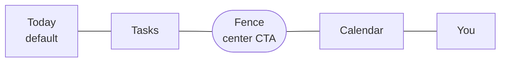

# Information Architecture

Fenced is three products in one app. The IA's whole job is to make that feel like one product with three surfaces, rather than three apps sharing a tab bar.

Two rules resolve most layout arguments:

1. **Starting a session is always one tap.** It is the most frequent action and the reason the app exists. Nothing outranks it.
2. **The app opens on a decision, not a database.** Landing on a full task list is landing on a chore. Landing on "here is today, here is what to do next, start" is landing on momentum.

Everything is marked **MVP** or **LATER**. There is no free/premium gating in the MVP — every user gets every shipped feature, subject only to age band. Where a feature varies by band, it is marked and the rules live in [Under-16 Compliance](06-youth-compliance.md).

---

## The shell

Five bottom tabs, with the session CTA occupying the center position as an elevated button.

| Tab | Purpose | Contains |
|---|---|---|
| **Today** | Home. What matters now. | Agenda, session CTA, streak, next up, insight teaser |
| **Tasks** | Everything not scheduled | Lists, filters, tags, projects |
| **Fence** | Start or manage sessions | Session sheet, presets, Fenced Hours, fence editor |
| **Calendar** | Time | Day/week/month, drag-to-schedule |
| **You** | Everything else | Insights, settings, account, data rights |

The center button is not a tab in the navigational sense — it opens the session sheet as a modal over whatever the user was doing. Style it distinctly (elevated, brand-colored, larger) so it reads as an action rather than a destination.

### Why the center CTA rather than a floating action button

The alternative is four tabs with a FAB on Today. The center button wins for specific reasons:

- **Available from every screen.** A FAB anchored to Today means starting a session from Calendar costs a tab switch plus a tap. For the primary action, that is one tap too many.
- **Positionally unmissable.** New users find it without instruction, which matters for a product whose core loop must be discovered in the first session.
- **It signals the differentiator.** Fenced competes with Todoist and Fantastical on features it will not win on for years. What it has is blocking. Making that the visual center is a positioning decision as much as a layout one.
- **A FAB collides with list content.** Tasks and Calendar both scroll and have their own contextual add buttons; a second floating button in the same corner creates ambiguity about what "+" means.

The cost is a five-item tab bar, which is at the upper bound of comfortable — and the reason every label must be one short word.

---

## Pre-app flow: onboarding and account

These screens sit outside the tab shell and run before the app proper. All **MVP** — see [user flows](01-user-flows.md) for the sequence and reasoning.

- Hook screen
- **Age assurance** — Declared Age Range system sheet on iOS 26+, neutral age screen (month + year, no pre-fill, no steering) elsewhere
- **Guardian consent** — under-13 only: guardian email collection, notice-sent confirmation, restricted-state explanation
- Sign in — Apple, Google, email
- Intent selection
- Distraction category selection
- Permission explainer, then the OS permission prompt
- App picker — system `FamilyActivityPicker` on iOS, custom picker on Android
- First session offer
- Notification permission, after the first completed session

---

## Tab 1: Today — MVP

The default landing screen and the only place the three products visibly merge. Vertically scrolling cards, ordered by time-sensitivity.

1. **Header.** Date, greeting, streak as a small fence-line glyph.
2. **Active session card** — only while a session runs. Time remaining, what is fenced, tap to expand. Takes the top slot and displaces everything else, because a running session is the only thing that matters while it runs.
3. **Next up.** The single next calendar event or highest-priority task due today. One item, not a list. If there is nothing, say so warmly rather than showing an empty container.
4. **Start a session.** Primary button duplicating the center tab for discoverability, showing the last-used preset ("Deep work · 90 min") so it is a one-tap repeat.
5. **Today's agenda.** Merged timeline of calendar events and scheduled tasks, with unscheduled tasks due today beneath. This merge is the core value proposition rendered as a list.
6. **Fenced Hours strip** — when a schedule exists today. "Fenced 14:00–16:00" with a skip-today affordance.
7. **Insight teaser.** One sentence, one number: "4h 10m focused this week, 12 shield hits — down 40%." Taps into Insights.
8. **Habit row** — LATER.

Empty state for a new user: the onboarding continuation card ("Try your first 5-minute session") replaces cards 3–8 until the first session completes.

---

## Tab 2: Tasks — MVP

A genuinely complete task manager. The MVP includes the structural features that were originally premium, because there is no tiering and a task list too weak to hold real work means users keep Todoist open.

**Default view:** grouped list — Overdue, Today, Tomorrow, This week, Later, No date.

**Screen inventory:**

| Screen | Status |
|---|---|
| Task list with swipe actions and multi-select | MVP |
| Task detail — title, notes, due date/time, estimate, priority, tags, subtasks, recurrence, linked event, focus time accumulated | MVP |
| Quick add bar, pinned above the tab bar, always visible | MVP |
| Filter and sort sheet | MVP |
| Projects and lists management | MVP |
| Completed archive | MVP |
| Voice capture (mic in quick add) | LATER |
| Board / kanban view | LATER |
| Tag view | LATER |
| Import from Notion/Trello | LATER |

**Natural-language quick add** is MVP using the local parser. For adult accounts, ambiguous input falls back to an LLM; for minors it asks the user to clarify instead. The parse always renders as editable chips.

---

## Tab 3: Fence (center CTA) — MVP

Tapping the center button opens the **session sheet** — a modal, not a full screen, so context stays visible behind it.

**Session sheet:**

- Preset selector, last used pre-selected
- Duration
- Fence selector — which apps
- Link a task (optional)
- **Strict mode toggle plus delay length picker.** The delay is chosen here, at arm time, and is immutable for the session. This is the entire point of the feature.
- Big start button

Everything is optional. Open, tap start, done.

**Behind the sheet, a "Manage" link opens the Fence hub** — configuration that does not belong in a quick-start modal:

| Screen | Status |
|---|---|
| Fences list — named app groups ("Social", "Work deep", "Evening") | MVP |
| Fence editor — system picker on iOS, custom on Android; category selection | MVP |
| Presets — named duration + fence + strict combinations | MVP |
| Fenced Hours — recurring schedules, per-day, with skip-today | MVP |
| Strict mode defaults — default delay length | MVP |
| Session history | MVP |
| Website domain list (Safari on iOS, extension on desktop) | LATER |
| Focus zones — location triggers | LATER |

**The active session screen** replaces the app shell entirely — no tab bar. Intentionally sparse: time remaining, the fence assembling, what is blocked, and an exit path. Removing the tab bar signals that the user is inside something and prevents idle app-browsing mid-session.

**The strict-mode delay countdown** is its own state on that screen: honest, showing exactly how long remains, with no way to shorten it.

---

## Tab 4: Calendar — MVP (local)

| Screen | Status |
|---|---|
| Day, 3-day, week, month views | MVP |
| Event detail and editor | MVP |
| Reminders configuration | MVP |
| Drag-and-drop scheduling of tasks onto slots | MVP |
| Fenced Hours shown as overlays, so scheduled blocking is visible in context | MVP |
| Connected accounts — Google, Outlook, Apple | LATER |
| "Find me time" AI scheduling entry point | LATER |
| Smart location/traffic-aware reminders | LATER |

The MVP calendar is local with reminders, and now also carries two-way Google Calendar sync and ICS export ([Theming and Calendar Interop](08-theming-and-calendar-sync.md)). Sync remains a project rather than a feature — recurrence expansion, timezones, tombstones, and conflict resolution — and a sync bug that double-writes a real meeting is unforgivable. Two settings screens cover it: **Calendar sync** (connect, direction, sync now) and **Export calendar** (subscribable link, .ics file).

When connected accounts do ship, the screen must label Apple differently from Google and Outlook rather than showing three identical rows: Apple sync is on-device and iOS-only, so it behaves differently by nature. See [platform constraints](05-platform-constraints.md).

---

## Tab 5: You

Everything that is neither now, nor a task, nor time. Grouped list.

**Progress**

| Screen | Status |
|---|---|
| **Insights** — the analytics dashboard | MVP |
| Habits | LATER |
| Achievements — XP, levels, badges | LATER |
| Leaderboards and accountability groups | LATER, adults and opted-in teens only |

**Connections** — mostly LATER

| Screen | Status |
|---|---|
| **Calendar sync** — connect Google, pick a calendar, sync direction, sync now | MVP, `child` band excluded |
| **Export calendar** — subscribable feed link, one-off .ics | MVP; feed is adults only, .ics all bands |
| Slack status sync, Notion/Trello import, Spotify, devices and sync status, browser extension pairing | LATER |

Both calendar screens live under Account (`/profile/calendar-sync`, `/profile/calendar-export`) and are reached from a **Calendar** section in the You tab. Age banding is explained in [Theming and Calendar Interop](08-theming-and-calendar-sync.md#age-banding).

**Account and data** — MVP unless noted

| Screen | Status |
|---|---|
| Profile | MVP |
| Notifications | MVP |
| **Appearance** — Paper light / Slate dark / System, defaults to System | MVP |
| Focus sounds and white noise (first-party) | MVP |
| **Age band and correction** — deliberate path, re-verified | MVP |
| **Guardian settings** — visible on `child` accounts: consent status, guardian contact | MVP |
| **Data export** — machine-readable, self-service | MVP |
| **Delete account** — real cascading deletion | MVP |
| **Privacy** — adult policy plus a separate child-friendly notice | MVP |
| Help, feedback, about | MVP |
| Themes | LATER |
| Subscription and plan management | LATER |
| Team/Family | LATER |

The data-rights screens are MVP because supporting minors requires them, and building them for minors means building them for everyone — which is the right outcome regardless.

### Insights structure, and why it differs by platform

This is the one screen where [platform constraints Finding 2](05-platform-constraints.md) forces divergence.

Sections that work everywhere (**MVP**):

- Focus time — today, week, month; by preset; hour-of-day heatmap
- Sessions — completed vs ended early, completion rate, average length
- **Shield hits** — how often the user reached for a fenced app, with week-over-week trend. The headline insight, and entirely first-party data.
- Streaks and weekday consistency
- Tasks completed during sessions; estimate accuracy
- Fenced Hours adherence

Then, platform-specific:

- **Android:** a "Most fenced apps" section with real app names and icons.
- **iOS:** a "Screen Time report" section embedding a native `DeviceActivityReport` view. Rich per-app data rendered by the system, never readable by your code, never present on the web dashboard.

Do not paper over this with a fake unified section. Label the iOS one honestly — "Rendered privately on your device by iOS; Fenced never sees this data" — which turns the limitation into a trust signal, and is particularly valuable for guardians of minor users.

**All Insights data is the user's own.** No cross-user comparison, no benchmarking, no profiling. That keeps the screen available to every age band without qualification.

---

## Guardian portal (web) — LATER

Deferred from MVP. Parent/guardian rights (consent status, export, deletion) can be handled in-app and via support email until a dedicated web surface ships.

---

## Cross-surface navigation

**Modals** (over current context, dismissible downward): session sheet, quick add, task detail, event detail, filter sheets, app picker.

**Full-screen takeovers** (shell hidden): onboarding, age assurance, active session, strict-mode delay countdown, shield screen (OS-drawn).

**Deep links** must all resolve, since widgets, notifications, and email point inward:

- `fenced://session/start?preset=deep-work` — start immediately, no sheet
- `fenced://session/active`
- `fenced://task/new?text=...` — share sheet and assistant target
- `fenced://task/{id}`
- `fenced://today`, `fenced://insights`
- `fenced://account/data` — export and deletion, for support and compliance replies

---

## Web app — LATER

Read-only when it ships. The web cannot block apps and cannot access iOS Screen Time data, so it must not pretend to be the mobile app in a browser.

**First release:** Today agenda, task list (view and complete), calendar view, Insights (first-party metrics only), account and data-rights management.

**Later:** task editing, calendar editing, AI scheduling proposals, team seat management.

**Never:** starting a device fence, per-app iOS data.

The browser extension is the web's blocking story: site blocking on desktop via MV3 `declarativeNetRequest`, driven by the same session state, so starting a session on the phone fences the laptop browser too. That cross-device continuity is genuinely valuable and is also the only place true per-site blocking works properly given the mobile constraints.

---

## Widgets and OS surfaces — LATER

- Small widget: streak plus one-tap start
- Medium widget: next event or task plus start button
- Lock screen / complication: time remaining in the active session
- Live Activity (iOS): active session with countdown — high value, since it keeps the session visible without opening the app
- Share sheet: capture a task from any app
- Siri / Google Assistant: "start a focus session," "add a task"

Widgets read from the App Group shared store, which the main app writes. Note this is the same App Group the iOS extensions use, and that the `DeviceActivityReport` extension cannot write to it — only the main app, `DeviceActivityMonitor`, and `ShieldAction` can.
