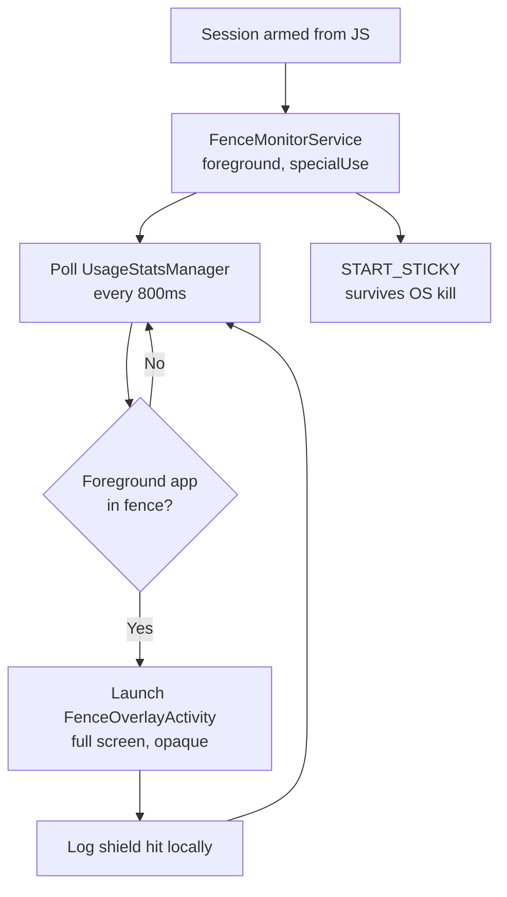

# Tech Stack

## Summary

| Layer | Choice | MVP |
|---|---|---|
| Mobile | React Native via Expo, TypeScript, prebuild/CNG | Yes |
| iOS blocking | Swift — FamilyControls, ManagedSettings, DeviceActivity + 3 app extensions | Yes |
| Android blocking | Kotlin — UsageStatsManager, `specialUse` foreground service, overlay | Yes |
| Auth | Clerk, with age band and jurisdiction on the user record | Yes |
| Age assurance | `DeclaredAgeRange` (iOS 26+), neutral age screen fallback | Yes |
| Parental consent | Third-party VPC vendor, US under-13 only | Yes |
| Monorepo | Turborepo, pnpm | Yes |
| API | TypeScript, Hono + tRPC on Vercel Functions | Yes |
| Database | Postgres (Neon) + Drizzle ORM | Yes |
| Cache / locks | Redis (Upstash) | Yes |
| Durable jobs | Vercel Workflow (WDK) or Inngest | Yes |
| Guardian portal | Next.js on Vercel | Later |
| AI | Local parser; LLM fallback for adults only, via Vercel AI SDK | Partial |
| Analytics | PostHog, adults only | Yes |
| Web dashboard | Next.js App Router | Later |
| Billing | RevenueCat + Stripe | Later |
| Extension | MV3, `declarativeNetRequest` | Later |

---

## Why Expo, given that blocking is native anyway

The blocking layer is hand-written Swift and Kotlin regardless of what wraps it. Screen Time app extensions must be Swift with SwiftUI; the Android foreground service must be Kotlin. No cross-platform framework abstracts either. So the framework choice is not "which one can do blocking" — none of them can natively — it is **which one best serves the other 85% of the app**.

That other 85% is a task manager, a calendar, an insights dashboard, a compliance and consent layer, and eventually a web app and AI scheduler. All of it is business logic and data modelling that wants to be shared. Choosing TypeScript means the natural-language parser, the recurrence rules, the age-band policy module, the API contract types, and the analytics aggregations are written once and consumed everywhere.

Flutter would give a slightly better-controlled native bridge for the blocking modules and would then require reimplementing all of that in Dart for the web. For a product whose differentiator is the *combination* of three domains, sharing domain logic matters more than a marginally cleaner native seam.

**Important caveat:** this is not the Expo managed workflow. Fenced needs `expo prebuild` (Continuous Native Generation) with real native directories, custom native modules, and four iOS targets. Expo Go is useless here — development happens on a custom dev client. Correct anyone joining who expects managed-workflow simplicity.

---

## Monorepo layout

```
fenced/
  apps/
    mobile/              Expo app
    api/                 Hono + tRPC
    web/                 Next.js dashboard (later)
    extension/           MV3 browser extension (later)
  packages/
    core/                Domain models, zod schemas
    policy/              Age band resolution + feature access
    nlp/                 Natural-language task parser
    scheduler/           Deterministic scheduling solver (later)
    sync/                Calendar sync reconciliation (later)
    api-client/          Generated tRPC client
    ui/                  Shared design tokens + primitives
    analytics/           Metric definitions and aggregations
  native/
    fenced-blocking/     Expo module: iOS + Android blocking
  targets/               iOS app extensions (Swift)
    device-activity-monitor/
    shield-configuration/
    shield-action/
```

Turborepo with pnpm. `packages/core` holds the zod schemas everything derives types from — one definition of a Task, one of a Session, shared by app, API, and database.

`packages/policy` is new and load-bearing. It is the single place that answers "may this user do this thing," taking the age band and jurisdiction as input. Every gate consults it. When monetization arrives, plan becomes a second input to the same module rather than a new set of conditionals scattered through the codebase.

The `targets/` directory sits at the repo root rather than inside `apps/mobile/ios` deliberately: `@bacons/apple-targets` links Swift sources from outside the generated `ios/` directory, so they survive `prebuild --clean`. Native code inside `ios/` gets destroyed by regeneration.

---

## Auth, age assurance, and the policy layer

This is the part that grew because of the under-16 decision, and it needs to exist before any behavioral data is collected.

### Auth

**Clerk**, with Apple, Google, and email. Apple Sign In is mandatory on iOS if any other social provider is offered.

Note that the earlier anonymous-first design is gone: you cannot establish an age band, obtain guardian consent, or correctly restrict processing for a user you know nothing about. Login now precedes the first session. See [user flows](01-user-flows.md) for how the ordering keeps this cheap.

### Age assurance

**iOS 26+:** the `DeclaredAgeRange` framework. Add the `com.apple.developer.declared-age-range` entitlement via the Declared Age Range capability in Xcode — unlike Family Controls, this one needs no manual approval.

```swift
let response = try await requestAgeRange(ageGates: 13, 16, in: viewController)
```

Up to three thresholds producing up to four ranges, each at least two years wide. Returns the range, whether it was self- or guardian-declared, and any active parental control flags. Responses are system-cached and synced across devices. Critically, **the system may override your thresholds based on region and local regulation**, which absorbs part of the EU consent-age patchwork for you.

**Everywhere else:** a neutral age screen collecting month and year only. No pre-fill, no steering, no retry loop.

**Store the derived band, not the input.** Persist band, jurisdiction, assurance method, and timestamp. Discard the birth month/year after resolution — the band is what the application needs, and being able to demonstrate you never retained the raw input is worth a lot.

### The policy module

`packages/policy` resolves the band and answers access questions. Non-negotiable rules:

- **Enforced server-side.** Client checks are UX, never security.
- **The jurisdiction consent-age table is configuration, not code**, with a named owner and a review cadence. It ranges from 13 to 16 across EU member states and cannot be hardcoded to any single value.
- **The UK Children's Code applies to all under-18s**, independently of consent age, so the policy module needs a distinct "Children's Code applies" flag rather than deriving everything from one threshold.

### Parental consent, US under-13

Use a **third-party VPC vendor**, ideally one operating under an FTC-recognized COPPA Safe Harbor program. Do not build this. The approved methods — government-ID matching, facial-recognition comparison, knowledge-based authentication — all involve processing categories of personal information that the amended COPPA Rule specifically expanded, and that is a large liability to assume for a small slice of users.

Until consent is verified, the account runs **local-only**: sessions and blocking work fully on-device, nothing behavioral syncs. This matters for retention — a child waiting on a parent's email should still be able to use the thing they downloaded.

Record consent events immutably: method, timestamp, guardian identifier, scope, and the notice version shown.

---

## iOS blocking implementation

### Required targets

Four bundle IDs, all needing the Family Controls entitlement and a shared App Group:

| Target | Purpose |
|---|---|
| Main app | Authorization, app picker, applying shields |
| `DeviceActivityMonitor` | Schedule start/end callbacks, strict-mode delay expiry |
| `ShieldConfiguration` | Customizes the shield screen appearance |
| `ShieldAction` | Handles shield button taps — **and logs shield hits** |

`ShieldAction` is worth noting: unlike the `DeviceActivityReport` extension, it *can* write to the App Group, which is how the shield-hit metric actually gets collected.

### Generating the targets

`@bacons/apple-targets` has a first-class `screen-time` target type and links targets outside `ios/`. Two configuration mistakes produce cryptic build failures:

1. **`ios.appleTeamId` must be set.** The plugin refuses to add extension targets without it.
2. **`ios.entitlements` must contain both Family Controls and the App Group.** The target configs read the App Group from `ios.entitlements['com.apple.security.application-groups'][0]`. Omit it and the build fails complaining about an unavailable group identifier, which does not point at the real cause.

```jsonc
{
  "expo": {
    "ios": {
      "bundleIdentifier": "com.fenced.app",
      "appleTeamId": "YOUR_TEAM_ID",
      "entitlements": {
        "com.apple.developer.family-controls": true,
        "com.apple.developer.declared-age-range": true,
        "com.apple.security.application-groups": ["group.com.fenced.app"]
      }
    },
    "plugins": ["@bacons/apple-targets", ["expo-build-properties", { "ios": { "deploymentTarget": "16.0" } }]]
  }
}
```

Then `npx expo prebuild --clean`, and verify in Xcode that all three extension targets exist before doing anything else.

**In a pnpm workspace**, add `@bacons/apple-targets` as a direct dependency of `apps/mobile` if prebuild reports it cannot be loaded — workspace resolver isolation otherwise hides it.

### Build vs. adopt

Evaluate **`react-native-device-activity`** (Kingstinct) before writing a custom module. It is the most mature wrapper — authorization, `startMonitoring`/`stopMonitoring` with schedules and events, family activity selection persistence, `updateShield`. **`expo-app-blocker`** goes further with both iOS and Android plus an inline picker and automatic target creation.

Recommended: start with `react-native-device-activity` to validate the entitlement and the core loop end to end, then fork or replace once you know which behaviors you need. Do not begin by writing your own — the failure modes here are obscure and undocumented, and a working reference saves weeks. Do plan to own this code eventually; it is the product's core differentiator and you cannot afford to be blocked on someone else's release cadence.

### Constraints to design around

- **Extension memory ceiling is roughly 6MB.** `DeviceActivityMonitor` callbacks run in a tightly limited process and get jetsammed if you do anything substantial. Write a flag to the App Group and let the main app do real work on next launch. Never attempt network calls or heavy computation in an extension.
- **Deployment target iOS 16.0.** Some Screen Time APIs exist in 15.x, but 16 is where the surface is coherent. Note `DeclaredAgeRange` requires iOS 26, hence the neutral-screen fallback.
- **`FamilyActivityPicker` is mandatory** for app selection — you cannot enumerate installed apps.
- **Shield application has latency.** `ManagedSettingsStore` changes are not always instantaneous; do not build UI assuming synchronous confirmation.
- **50 `ManagedSettingsStore` instances maximum.** Use named stores per fence and clean up unused ones.
- **Web domain filtering is Safari-only**, capped at 50 domains, and disables Safari private browsing.
- **Use `.individual` authorization** for all users including minors. Parent-managed `.child` mode via Family Sharing is a different product; see [youth compliance](06-youth-compliance.md).

---

## Android blocking implementation

Kotlin, in the same Expo module. Per [platform constraints Finding 3](05-platform-constraints.md), **no `AccessibilityService`** — a Play policy dead end, and Android 17.2 restricts it at the platform level.

### Architecture



### Permissions and manifest

- **`PACKAGE_USAGE_STATS`** — special permission, no runtime dialog. Send the user to `ACTION_USAGE_ACCESS_SETTINGS` and verify on resume. Budget a dedicated explainer screen; this is the biggest Android onboarding drop-off.
- **`SYSTEM_ALERT_WINDOW`** — for the overlay. Android 12+ blocks overlaying Settings, so the revoke path stays reachable.
- **`FOREGROUND_SERVICE_SPECIAL_USE`** with the reviewer-facing justification property shown in the constraints doc.
- **`REQUEST_IGNORE_BATTERY_OPTIMIZATIONS`** — necessary for session reliability.
- **Avoid `QUERY_ALL_PACKAGES`** (restricted on Android 11+). Use `getInstalledApplications` filtered by launcher intent for the picker.

### Reliability work you must budget for

OEM process killers are the leading cause of "it just stopped working" reviews in this category:

- `START_STICKY` plus persisted session state, so a killed service resumes the correct fence — including the strict-mode delay — on restart.
- Detect the OEM and surface autostart guidance. MIUI, Samsung's unmonitored-apps list, Huawei, Oppo and Vivo each need different instructions.
- A watchdog `AlarmManager` verifying the service is alive during an active session, restarting it if not.
- Reconcile on foreground: if the service died mid-session, decide whether the session is still valid and tell the user honestly rather than silently crediting focus time that was never enforced.

Do not poll faster than ~800ms; battery cost rises with no meaningful UX gain. Make the overlay entrance fast and fully opaque so the interception feels decisive despite the latency.

---

## Backend

### API

**Hono + tRPC on Vercel Functions.** tRPC gives end-to-end type safety from `packages/core` schemas to the clients with no codegen step, which is the main practical payoff of committing to TypeScript everywhere. Hono keeps cold starts small and provides normal HTTP routes for webhooks (VPC vendor callbacks now; calendar push channels and billing events later) that tRPC fits poorly.

### Data

**Postgres on Neon, with Drizzle ORM.** Drizzle's schema is TypeScript that composes with the zod schemas in `packages/core`, so database shape and API contract cannot drift.

Schema notes specific to this design:

- `users` carries `age_band`, `jurisdiction`, `assurance_method`, `assurance_at`, and a `childrens_code_applies` flag. No birthdate column.
- `consent_events` is append-only: never update or delete a consent record.
- `sessions` stores the strict-mode delay as an immutable field set at arm time.
- Recurring tasks store `RRULE` strings plus materialized instances within a rolling window, rather than expanding recurrence at query time.

**Redis on Upstash** for rate limiting and distributed locks. Locks matter later for calendar sync — two concurrent sync runs for one account will duplicate events in a user's real calendar, the least forgivable bug this product can ship.

### Durable jobs

**Vercel Workflow (WDK)** to stay entirely on Vercel, or **Inngest** for richer fan-out and step-level observability.

MVP jobs:

- **Streak rollover** at each user's local midnight. Must be per-user in the user's own timezone and idempotent, or a user flying between timezones loses or doubles a streak day — exactly the bug that makes people rage-uninstall a habit product.
- **Retention enforcement** — scheduled deletion per the published retention policy. This is a COPPA requirement, not a nice-to-have, and it must be a real job rather than a paragraph in a privacy policy.
- **Deletion cascade** — account and guardian-initiated deletion, with a stated completion window.
- **Export generation** — machine-readable bundles.
- **Analytics rollups** for adult accounts only.

Later: incremental calendar sync per account, webhook renewal (Google channels and Graph subscriptions both expire), nightly AI scheduling, subscription reconciliation.

---

## Sync strategy

**Server is the source of truth. Optimistic writes with a durable offline mutation queue.**

Explicitly **not** a local-first CRDT engine (ElectricSQL, PowerSync, Zero) in v1. The payoff is small here:

- Focus sessions, the one thing that must work offline, are device-local by nature. The session runs on the device, the OS applies the shield, and results sync later.
- Tasks and calendar events are low-contention. A single user editing their own list rarely conflicts, and field-level last-write-wins is adequate.
- External calendar events will have an authoritative upstream owner imposing its own conflict semantics regardless of what you do locally.

Implementation: SQLite via `expo-sqlite` or `op-sqlite` locally, TanStack Query for server state with optimistic mutations, and a persisted mutation queue that replays on reconnect with idempotency keys so retries cannot double-create. Server writes carry `updated_at` and a version for field merging.

**The local-only mode for pending-consent accounts uses the same machinery** — the mutation queue simply is not drained until consent is verified. That is a useful reuse rather than a special case.

Revisit local-first only if team shared lists turn out to be genuinely concurrent in practice.

---

## AI

### The division of labor

**A deterministic solver places tasks. An LLM only reads and writes language.**

`packages/nlp` tries local parsing first. `packages/core` `autoSchedule` / `proposeTimeBlocks` place blocks. `packages/ai` + `apps/api` `ai.*` procedures are the **only** provider boundary: adult-gated via `canAccess`, structured Zod output, zero calendar side effects.

Adult features: `ai.parseTask`, `ai.adviseReplan`, `ai.weeklyCoach`, `ai.planningChat` (tool allowlist: `propose_schedule` | `parse_task` | `none`). Kill switch: `AI_ENABLED=false`.

For `child` and `teen` the local parser + clarify chips and the deterministic scheduler are the only paths.

---

## Analytics and observability

- **PostHog** — adults only. Initialize the SDK with tracking disabled and enable it only once the band resolves to `adult`. Since the band resolves during onboarding before any session exists, no minor behavioral data is ever captured. Self-host or use the EU region.
- **Sentry** — crash reporting across mobile and API. May run for minors, but scrub it: no user identifiers, no content, no screenshots, no session replay.
- **No advertising SDKs, ever.** This sidesteps Play's Families Self-Certified Ads SDK requirements entirely. Verify no dependency pulls one in transitively, and note Play treats users of unknown age as children for ad purposes.
- **Custom funnel instrumentation** on the onboarding ladder — age assurance, auth, permission grant, first session — each as a distinct event. This funnel decides whether the product succeeds, and per-step visibility is the only way to improve it. Implement it as first-party server-side events so it works regardless of the analytics SDK's per-band state.

Never send blocked-app identity anywhere. On iOS you cannot; on Android you must choose not to.

---

## Billing — later

No billing in the MVP. When it ships: **RevenueCat** for consumer subscriptions (receipt validation, cross-platform entitlement, introductory offers) and **Stripe** for seat-based team plans, since Apple IAP has no seat model.

Entitlements will resolve through the same `packages/policy` module that already handles age bands — plan becomes a second input. Building that module now is what makes adding billing later a contained change.

---

## Build order

**Phase 0 — before product code.** Request the Family Controls distribution entitlement for all four bundle IDs, referencing the youth-compliance design in the justification. Multi-week external dependency; everything below proceeds in parallel but nothing ships without it. Start the legal engagement for the items marked **[LEGAL]** in [youth compliance](06-youth-compliance.md), and begin the DPIA.

**Phase 1 — prove the risk.** Monorepo skeleton. Expo prebuild with all three iOS targets confirmed in Xcode. `react-native-device-activity` wired up, a shield applied and lifted on a real device. Android foreground service and overlay working. No product UI. The only goal is proving the blocking layer works on both platforms before investing in anything else.

**Phase 2 — account and compliance foundation.** Clerk auth, age assurance on both platforms, `packages/policy`, the user schema with band and jurisdiction, VPC vendor integration (email/API, not a separate web portal in v1), data export and deletion, retention job. This is unglamorous and it must precede any behavioral data collection, which is precisely why it is Phase 2 and not Phase 5.

**Phase 3 — the MVP product.** Session start/stop, fence editor, presets, Fenced Hours, strict mode with the arm-time delay, streaks, tasks with subtasks/tags/priorities/recurrence, local NL quick add, local calendar with reminders, Insights, first-party focus audio, sync. Full onboarding.

**Phase 4 — MVP hardening and launch.** OEM reliability work, accessibility, store submissions with age ratings and target-audience declarations, DPIA completed, child-friendly privacy notice.

**Phase 5 — expansion.** Two-way calendar sync, AI auto-scheduling, voice-to-task, kanban, habits, gamification, web dashboard, browser extension, widgets and Live Activities, integrations.

**Phase 6 — monetization and teams.** Tiering, paywalls, RevenueCat, Stripe, team plans. Then location zones, once you have usage data to justify the background-location declaration.

Phase 1 is the one to protect. Every other phase is conventional application work with predictable risk; Phase 1 contains all the unknowns, all the entitlement exposure, and all the platform behavior that cannot be verified from documentation alone.
